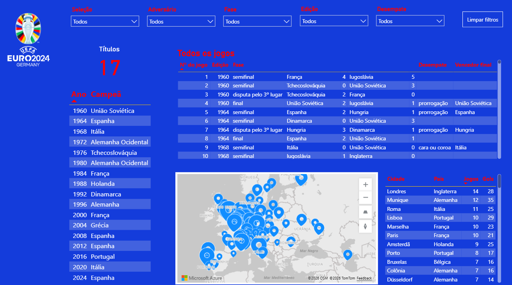
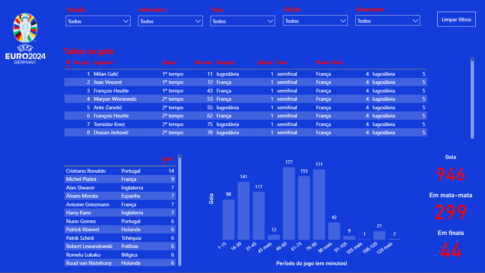
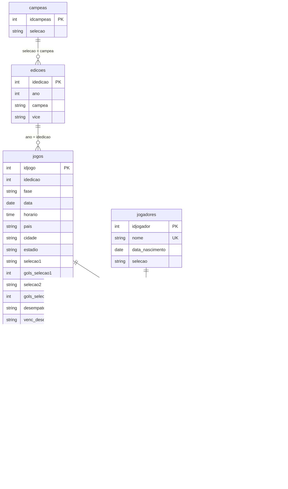

# Todos os gols da história da Uefa Euro

Projeto de análise e visualização de dados sobre a história da Euro, a principal competição de seleções de futebol da Uefa. O projeto reúne informações sobre edições, partidas, resultados, gols e jogadores, com consultas SQL e um relatório interativo desenvolvido no Power BI.

> **English:** Data analysis and visualization project on the history of the Uefa European Championship, from 1960 to 2024. It brings together editions, matches, results, goals and players, with SQL queries and an interactive Power BI report. The report is in Portuguese.

[**Clique aqui para acessar o relatório no Power BI**](https://app.powerbi.com/view?r=eyJrIjoiMGY4MWY1MTUtYzY1ZS00MDU5LTgzNDMtYmQxYWM0NzRkNTg1IiwidCI6ImFmNmE0MmI1LWJkMGUtNDUwNS1iMDdmLWY5MTdiMGNlMmYzZCJ9)

## Visão geral do relatório

O relatório tem quatro páginas. Em todas elas, os filtros no topo (seleção, adversário, fase, edição e desempate, com o botão "Limpar filtros") atualizam os visuais.

- **Todos os jogos**: campeão de cada edição, número de títulos, lista de todos os jogos e mapa das cidades-sede, com jogos e gols por cidade.
- **Gols e goleadas**: gols marcados e sofridos por seleção, jogos com mais gols, maiores goleadas e média de gols por edição.
- **Todos os gols**: lista completa dos gols, artilheiros, gols por período do jogo e gols em mata-mata e em finais.
- **Desempenho das seleções**: vitórias, empates e derrotas (inclusive em prorrogação e pênaltis), relação entre gols marcados e sofridos e os atletas mais velhos e mais novos a marcar um gol.

## Objetivos

- Organizar dados históricos das edições da Uefa Euro.
- Analisar partidas, resultados e gols ao longo da história do torneio.
- Explorar informações dos jogadores que já marcaram gol na competição.
- Utilizar SQL para consultar, validar e transformar os dados.
- Desenvolver visualizações no Power BI para facilitar a análise dos dados.

## Tecnologias utilizadas

- **SQL Server:** armazenamento, consulta e transformação dos dados.
- **SQL:** consultas exploratórias, verificações de consistência e criação de uma view auxiliar.
- **Power BI:** criação do relatório interativo e visualização dos dados.
- **DAX:** criação de medidas e cálculos utilizados no modelo de dados e nas análises.

## Banco de dados e consultas SQL

O banco reúne tabelas relacionadas a:

- **Edições:** informações sobre as edições da competição.
- **Jogos:** data, fase, seleções, placar e informações sobre o local das partidas.
- **Gols:** registros dos gols e informações associadas, como jogador e minuto.
- **Jogadores:** informações pessoais dos jogadores.
- **Participantes:** nomes das seleções e correspondência entre nomes históricos e atuais.
- **Resultados:** informações estruturadas sobre os resultados das partidas.

As relações do diagrama são lógicas: as tabelas têm chave primária, mas o banco não declara chaves estrangeiras. Os nomes de tabelas e colunas aparecem sem acento no diagrama. Na tabela `jogos`, o campo `idedicao` guarda o ano da edição.

O script SQL inclui consultas exploratórias e verificações de consistência, como a identificação de gols associados a jogadores não cadastrados, a conferência de minutos dos gols e a busca por possíveis divergências nos resultados.

### View `resultados_atualizados`

A view consolida os resultados das partidas em duas linhas por jogo — uma para cada seleção. Ela apresenta os gols marcados e sofridos por cada equipe, o adversário e informações contextuais da partida. Também utiliza a tabela de participantes para relacionar nomes históricos de seleções aos nomes atuais.

Essa estrutura facilita análises por seleção sem precisar separar a equipe mandante ou a primeira seleção da segunda seleção em colunas diferentes.

## Fontes de dados

- **[Uefa Euro](https://www.uefa.com/uefaeuro/):** fonte das informações sobre partidas e gols.
- **[Transfermarkt](https://www.transfermarkt.com/):** fonte de informações pessoais dos jogadores.

Os dados foram coletados para fins de estudo e portfólio.

## Estrutura do projeto

- `dump_euro.sql`: arquivo de exportação do banco de dados.
- `script_euro.sql`: consultas SQL, verificações de consistência e criação da view `resultados_atualizados`.
- `.pbip-files/`: arquivos do projeto do Power BI.

## Aviso

Este é um projeto independente de portfólio, sem vínculo com a UEFA. O nome UEFA EURO e o logotipo do torneio são marcas da UEFA.
